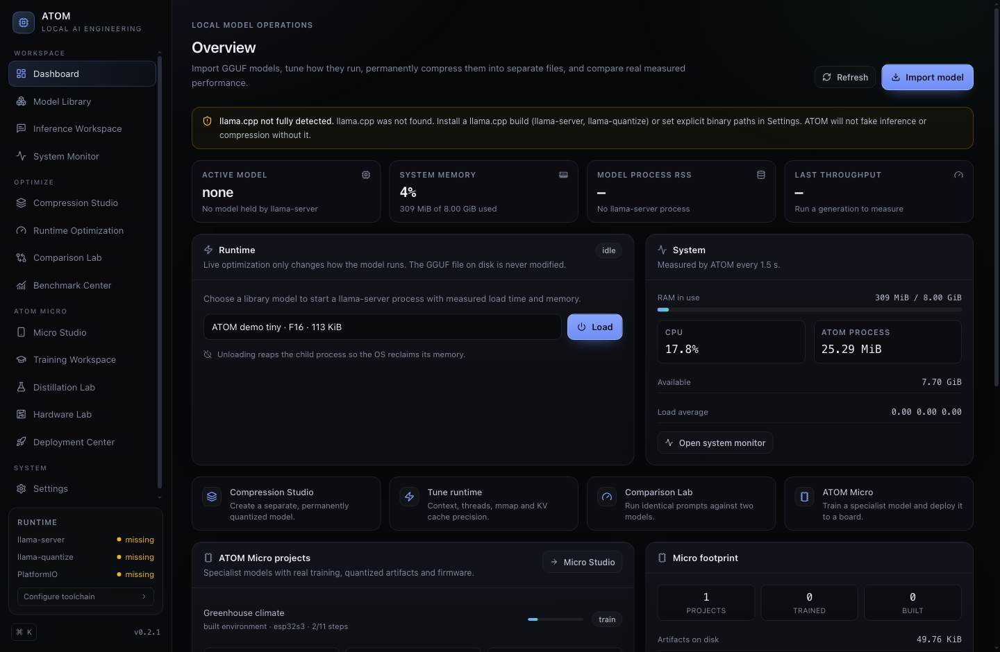
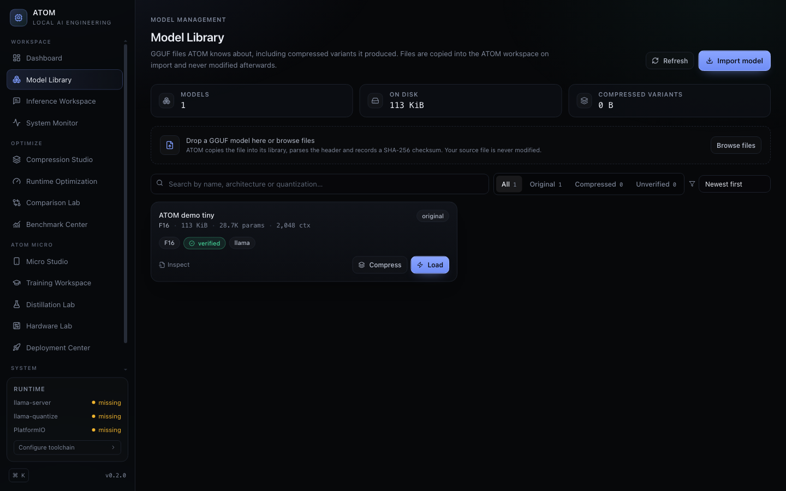
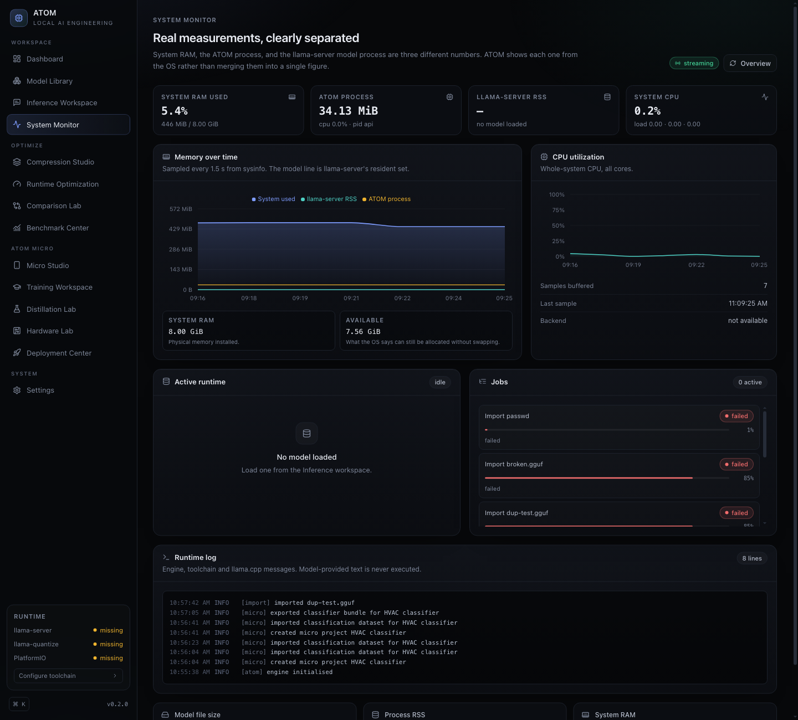
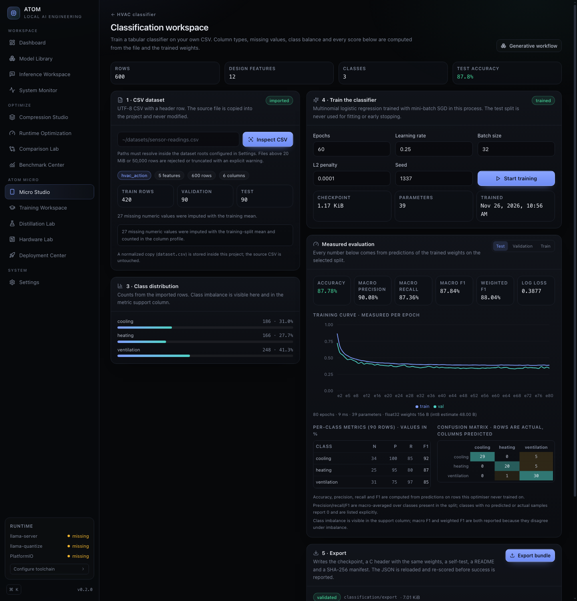
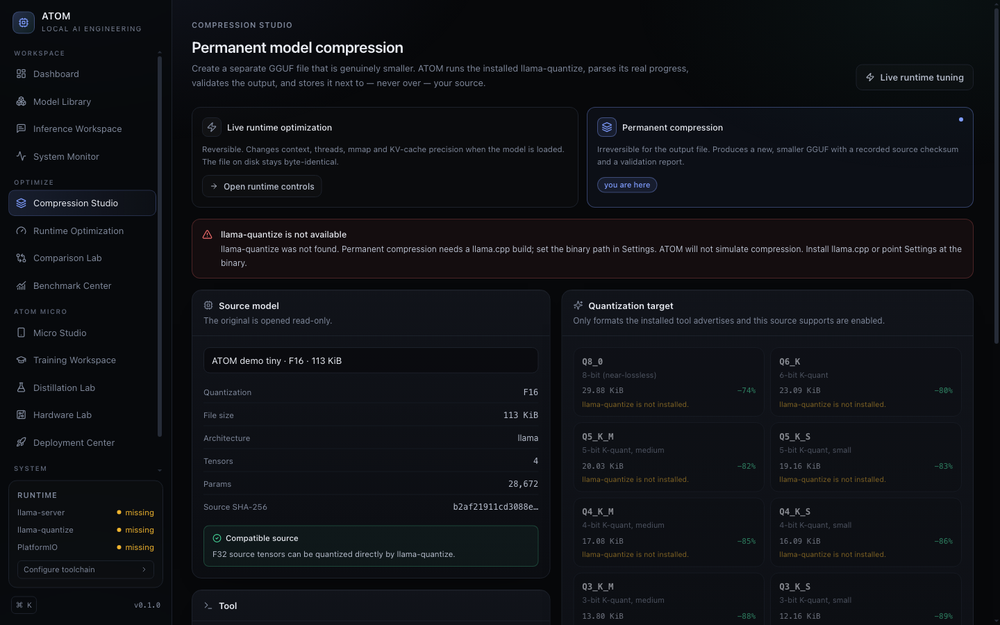
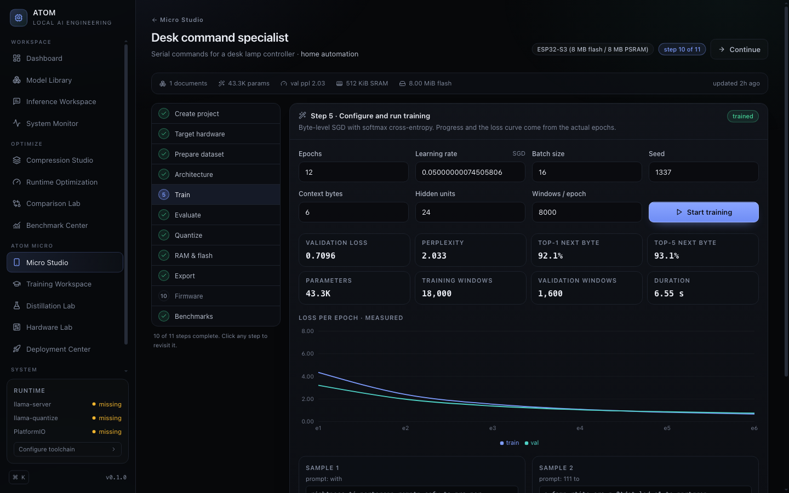

# ATOM — Adaptive Tiny Operating Model

A local-first desktop application for importing GGUF language models, tuning how
they run, **permanently** compressing them into separate files, comparing
original vs. compressed behaviour with measured numbers, and training/exporting
tiny specialist models for microcontrollers with **ATOM Micro** — including a
tabular classification workflow that trains on your own CSV and reports real
accuracy, precision, recall, F1 and a confusion matrix.

Built in Rust (Tauri shell, axum API, llama.cpp backend) with a React +
TypeScript + Tailwind interface.

> ATOM is a developer tool, not a chatbot demo. Every metric shown is either
> measured from the OS or the tool's own output, or clearly labelled as an
> estimate. When llama.cpp is missing, ATOM says so and disables the feature
> instead of simulating it.

---

## Screenshots

| Dashboard | Model library |
| :---: | :---: |
|  |  |
| **System Monitor** | **ATOM Micro — classification** |
|  |  |
| **Compression Studio** | **ATOM Micro — a measured training run** |
|  |  |

Captured from the running application at 1440 px wide. Every number is either
read from the machine or computed by ATOM: the compression figures are real
per-tensor size estimates, the loss curve is the recorded result of an actual SGD
run, and the classifier scores come from predictions on a held-out split.

The model in the library is a small GGUF fixture (`scripts/make_demo_gguf.py`) and
the classifier was trained on a **synthetic CSV generated for the smoke test**
(`scripts/make_classification_fixture.py`). They exist so the workflow can be
exercised without a multi-gigabyte model or someone's private data. llama.cpp and
PlatformIO are genuinely absent from that machine, which is why those panels show
an unavailable state instead of plausible-looking values.

---

## Status at 0.2

| Area | Label | What that means here |
| --- | --- | --- |
| GGUF import, inspection, checksums, duplicate detection | **Available** | Parsed by ATOM's own header reader; SHA-256 recorded on every import |
| Runtime tuning (context, threads, batch, mmap, KV cache) | **Requires external dependency** | Needs `llama-server`; verified against a stub process, not a real model |
| Permanent compression | **Requires external dependency** | Needs `llama-quantize`; formats are read from that binary's own help output |
| Benchmarking and comparisons | **Requires external dependency** | Needs `llama-server`; all metrics measured, quality is rule-based |
| ATOM Micro generative specialists | **Available** | Byte-level MLP trains in-process; firmware steps need PlatformIO |
| ATOM Micro CSV classification + export | **Experimental** | Real training and metrics; validated on a synthetic fixture, not on a device |
| Firmware build / flash / device benchmarks | **Requires physical hardware** | Generated project is real; building needs `pio`, flashing needs a board |
| Model downloads, GPU memory probing, agent features | **Planned** | No code path exists, and the UI says so |

## Two optimization modes, deliberately separate

| | Live runtime optimization | Permanent compression |
| --- | --- | --- |
| What changes | How llama.cpp loads and runs the model | A new GGUF file on disk |
| Reversible | Yes — unload/reload | No, the output is a new artifact |
| Knobs | context, threads, batch, mmap, mlock, flash-attn, GPU layers, KV-cache precision, memory budget | llama-quantize type (Q8_0 … Q2_K) |
| Original file | Never modified | Never modified, never deleted |
| Evidence | load time, RSS, TTFT, tok/s | size delta, checksums, validation report |

ATOM does **not** claim dynamic weight compression, layer skipping or
"intelligent" sparsity. Those are not operations llama.cpp exposes here, so they
are not offered.

---

## What is implemented

- **Model library** — GGUF v1–v3 header/metadata/tensor parser written in this
  repo, streaming SHA-256, import by path or upload, a fully interactive drop
  zone with signature checking before a job starts, duplicate detection by
  checksum, filter/search, variant links (compressed → source), verification and
  tamper detection.
- **Permanent compression** — detects the installed `llama-quantize`, reads the
  quantization types *its own help output advertises*, computes real per-tensor
  size estimates, runs it with an explicit argv, parses its `[n/total]` tensor
  progress, supports cancellation, deletes partial output, then re-parses and
  validates the result before it enters the library.
- **Inference** — supervises `llama-server` (HTTP), streams tokens, cancels
  immediately, measures TTFT/throughput/load time, and samples the child
  process's real RSS.
- **Comparison Lab** — identical prompts and runtime settings across 1–3 models;
  disk, throughput, latency, peak RSS, per-suite pass rates, repeat-consistency;
  Markdown + JSON reports; history.
- **System monitor** — sysinfo-backed samples streamed over SSE, with system RAM,
  ATOM process RSS and model process RSS kept visibly separate. Chart axes are
  laid out with reserved label widths, so ticks read `143 MiB` or `75%` rather
  than being clipped.
- **Quality suites** — deterministic, rule-checked cases for instruction
  following, knowledge, reasoning, arithmetic, coding and consistency. Results
  are labelled automated estimates, never "intelligence scores".
- **ATOM Micro classification** — CSV profiling (inferred column types, missing
  and invalid values, class balance), grouped leakage-safe splits, an in-process
  multinomial classifier, measured accuracy/macro precision/recall/F1/weighted
  F1/log loss with a per-class table and confusion matrix, and a validated export
  bundle (JSON checkpoint, C header, self-test, SHA-256 manifest).
- **ATOM Micro** — a complete 11-step workflow (project → board → dataset →
  architecture → training → evaluation → quantization → memory plan → export →
  firmware → device benchmarks) backed by the `atom-micro` crate. Byte-level MLP
  specialists train in-process with real SGD; exported int8/int4 artifacts ship
  with a C runtime, a host harness that is compiled and measured by ATOM, and a
  generated PlatformIO project for the selected board.
- **Desktop shell** — Tauri 2 app that hosts the same API on a loopback port and
  loads the same UI.
- **CLI** — `atom status | inspect | models | formats | import | quantize`.

## ATOM Micro

ATOM Micro is a separate, self-contained pipeline for specialists that fit on a
microcontroller. It is not a wrapper around a cloud API and it does not fake a
training run.

| Step | Operation | What is real |
| --- | --- | --- |
| 1–2 | Project and target board | project persisted on disk; board limits from `atom-micro` hardware tables |
| 3 | Dataset import | file copied into the ATOM home, document/byte stats, deterministic train/val split |
| 4 | Architecture | 3 built-in MLP specs (parameters computed from the spec), 2 transformer specs that require PyTorch |
| 5 | Training | real byte-level MLP, in-process SGD, per-epoch train/validation loss, cancellable job |
| 6 | Evaluation | measured validation windows, perplexity and next-byte accuracy |
| 7 | Quantize | symmetric per-row int8/int4 with measured size ratio and loss delta |
| 8 | RAM / flash | weight bytes plus activation/heap estimate against the board's datasheet limits (labelled estimate) |
| 9 | Export | `model.bin`, `model.c/h`, `runtime.c`, `main.c`, manifest with SHA-256, README, then a host compile + benchmark check |
| 10 | Firmware | generated PlatformIO project, `pio run`, upload and serial monitor; requires PlatformIO |
| 11 | Benchmarks | import a device JSON report or read serial `bench` output; fabricated/zero numbers are rejected |

Architectures that need PyTorch (transformers) are listed but disabled with the
exact requirement. Firmware build, flashing and teacher-model distillation report
an unavailable state when PlatformIO, a serial port or a loaded `llama-server`
teacher are missing — they never simulate success.

## ATOM Micro classification

The classification workspace is a second Micro workflow for tabular data. It is
reachable from any project (**Classify CSV**) and does not affect the generative
steps.

| Stage | What is real |
| --- | --- |
| CSV import | UTF-8 with a header row, RFC 4180 quoting, 20 MiB / 50 000 row limits; a normalized copy is stored in the project and the source is untouched |
| Column profile | Type inferred per column (numeric/categorical), missing and unparsable counts, unique values, examples — all from the parsed rows |
| Roles | Target label plus any number of input features (≤ 48 columns, ≤ 256 design features after one-hot encoding) |
| Split | Grouped by identical row so an exact duplicate cannot appear in two splits; train/validation/test counts are reported |
| Training | Multinomial logistic regression, mini-batch SGD with L2, seeded, cancellable, epoch-by-epoch training/validation loss |
| Metrics | Accuracy, macro precision/recall/F1, weighted F1, log loss, per-class support/predicted/precision/recall/F1 and the full confusion matrix on the selected split |
| Export | `classifier.json`, `model.h` (same weights as C arrays), `classifier.c` (self-test), `README.md`, `manifest.json` with SHA-256 of every file |

The export is validated before success is reported: ATOM reloads the JSON
checkpoint, re-scores the held-out test split and requires the accuracy to match
the report. When a host C compiler exists it also compiles and runs the generated
self-test.

Measured in this VM on the synthetic fixture (600 rows, 5 features, 3 classes,
80 epochs): **87.8 % test accuracy**, macro F1 87.8 %, weighted F1 88.0 %, log
loss 0.388, 39 parameters, 1.2 KiB checkpoint. That is a smoke test of the
pipeline, not a claim about any real dataset.

## Supported formats

| Direction | Format | Notes |
| --- | --- | --- |
| Import | GGUF v1–v3 | Header/metadata/tensor table only; tensor payloads are never executed |
| Compression output | GGUF, formats advertised by the installed `llama-quantize` | Q8_0 … Q2_K where the binary supports them |
| Micro generative checkpoint | `ATOMLM1` (float32) | Native format, loaded by ATOM and exported to C |
| Micro quantized container | `ATOMQ1` (f16/int8/int4) | Symmetric per-row scales, documented in `atom-micro` |
| Micro classifier | `ATOMCL1` JSON + C header | Portable weights and encodings |
| Micro datasets | UTF-8 text, JSON, JSONL, CSV | Classification requires CSV with a header |

## Architecture

```
                    ┌─────────────────────────────────────────────┐
                    │  Tauri window (Windows / Linux)             │
                    │  └─ loads http://127.0.0.1:<ephemeral>      │
                    └───────────────┬─────────────────────────────┘
                                    │ HTTP + SSE
                    ┌───────────────▼─────────────────────────────┐
                    │  atom-api (axum)                            │
                    │  REST routes · SSE streams · embedded UI    │
                    └───────────────┬─────────────────────────────┘
                                    │
                    ┌───────────────▼─────────────────────────────┐
                    │  atom-engine (composition root)             │
                    │  jobs · runtime · comparisons · micro        │
                    └──┬───────┬────────┬────────┬────────┬───────┘
                       │       │        │        │        │
                  atom-models │  atom-inference  atom-bench  atom-micro
                       │       │        │        │        │
                  atom-security atom-compression atom-memory (sysinfo)
                       │
                  atom-core (config, errors, job registry, logs)

React + TypeScript UI ──HTTP/SSE──> the same router in dev and desktop
```

## Requires an external llama.cpp build

ATOM does **not** ship or download inference binaries.

- `llama-server` → inference, chat, benchmarking
- `llama-quantize` → permanent compression

Set explicit paths in **Settings**, or put them on `PATH`. Both the API and the
UI report precisely which of the two is missing and what that disables.

## Quick start

```bash
# 1. Backend + API
cargo build --release
ATOM_HOME="$HOME/.atom" ./target/release/atom-api      # http://127.0.0.1:8787

# 2. UI for development (proxies /api to the API)
cd frontend
bun install
bun run dev                                            # http://127.0.0.1:3003

# 3. Production UI, served by the API
bun run build                                          # writes frontend/dist
```

## Desktop app (Windows + Linux)

ATOM runs as a native desktop application: the Rust core, the API and the
compiled interface are embedded in one executable, the window is served from an
ephemeral loopback port, and no browser, terminal or `frontend/dist` folder is
needed on the target machine.

```bash
# Linux: .deb + AppImage (needs WebKitGTK 4.1 dev packages)
scripts/build-desktop.sh

# Windows: NSIS .exe + .msi (run in PowerShell, needs Rust MSVC + WebView2)
scripts\build-desktop.ps1
```

Prebuilt installers for both platforms are published on the
[Releases page](https://github.com/SadXresto/atom/releases). Installers land in
`apps/desktop/target/release/bundle/` when you build locally. Pushing a `v*` tag runs
[.github/workflows/desktop.yml](.github/workflows/desktop.yml), which builds and
attaches both platforms' installers to the GitHub release. Full prerequisites and
data locations: [apps/desktop/README.md](apps/desktop/README.md).

CLI:

```bash
./target/release/atom status
./target/release/atom inspect ~/Models/model-f16.gguf
./target/release/atom import ~/Models/model-f16.gguf
./target/release/atom formats <model-id>
./target/release/atom quantize <model-id> Q4_K_M
```

## Repository layout

```
crates/
  atom-core/        config, errors, job registry, log buffer
  atom-security/    path allowlist, checksums, input validation, argv rules
  atom-models/      GGUF parser, quant catalog, library, import, verification
  atom-memory/      sysinfo sampling (system + per-process)
  atom-inference/   llama-server supervision, streaming, tool probing
  atom-compression/ quantize planning, execution, output validation
  atom-bench/       deterministic suites, scoring, comparison store/reports
  atom-micro/       boards, datasets, MLP model, quantization, export, firmware, benchmarks,
                    CSV classification (classify.rs)
  atom-engine/      composition root used by API, CLI and desktop
apps/
  api/              axum HTTP + SSE surface, serves the built UI
  cli/              `atom` command
  desktop/          Tauri 2 shell: embeds the UI, Windows/Linux bundle config, icons
frontend/
  src/components/   design system, charts, job console, comparison view
  src/pages/        Onboarding, Overview, Library, Compression, RuntimeOptimization,
                    Comparison, Inference, Benchmarks, MicroProjects, MicroStudio,
                    Training, Distillation, Hardware, Deployment, Monitor, Settings
docs/               architecture and verification notes
```

## Safety properties enforced in code

- Every path is canonicalized and checked against an allowlist of roots
  (`PathGuard`); traversal and symlink escapes are rejected.
- External tools are spawned with explicit argv — never through a shell.
- Output paths are refused when they equal the source path; source files are
  never deleted by ATOM.
- Partial or invalid quantization output is deleted, never presented as success.
- Job cancellation kills the child process and reaps it.
- A second import of a file whose SHA-256 is already in the library is refused
  and the redundant copy is deleted.
- Classification splits are grouped by identical row, so an exact duplicate can
  never appear in both training and test.
- Model metadata is parsed as data only; nothing from a model file is executed.
- Network access is off by default, and no download code path exists yet.

## Tests

```bash
cargo test --workspace     # 89 tests: parser, security, quantize, scoring, engine jobs,
                           # Micro training/export/quantization/classification, plus
                           # stub-driven process/streaming integration tests
cd frontend && ./node_modules/.bin/tsc --noEmit && bun run build
```

The classifier suite covers CSV quoting/newlines, type and missing-value
profiling, the single split-assignment invariant (membership and the
train/validation/test index vectors are one structure, and duplicate rows never
cross splits), training on separable data, metric/confusion consistency,
cancellation, and the export round-trip (reloaded checkpoint re-scores to the
same accuracy).

`crates/atom-teststubs` holds two dev-only executables that impersonate
`llama-quantize` and `llama-server`. The integration tests spawn them as real
child processes, so cancellation cleanup, output validation, measured load time
and SSE token streaming are exercised without a llama.cpp build or a real model.

See [docs/VERIFICATION.md](docs/VERIFICATION.md) for exactly what was verified in
the build environment and what was not.

## Testing status (0.2)

| Feature | Status | Evidence |
| --- | --- | --- |
| GGUF import | **Tested** | Live API: valid GGUF imported; duplicate import rejected and the extra copy removed; non-GGUF rejected with "missing GGUF magic"; path outside the allowlist rejected |
| GGUF inspection | **Tested** | Parser unit tests plus a profile of an imported file (28,672 params, 2,048 ctx, tensor mix) |
| Permanent quantization | **Blocked** | No `llama-quantize` in this VM; stub-process integration tests cover argv, progress, cancellation cleanup and output validation |
| Runtime optimization | **Blocked** | No `llama-server`; stub tests cover load timing, streaming, cancellation and unload/reap |
| Inference | **Blocked** | Same reason; the UI reports the binary as missing rather than simulating a reply |
| Benchmarking | **Blocked** | Requires a model + backend; scoring and reporting are unit-tested |
| Micro training (generative) | **Tested** | Real SGD run in this VM (loss 4.349 → validation 0.7096, perplexity 2.03) |
| Micro classification | **Tested** | Live API: 600-row CSV → 420/90/90 split → 80 epochs → 87.8 % test accuracy → export validated and compiled |
| Model export (classifier) | **Tested** | JSON reloaded and re-scored (90 rows, accuracy matched), C self-test compiled with `cc` and printed `predicted=heating actual=heating` |
| Model export (generative) | **Tested** | Export bundle + host compile/benchmark from the existing Micro pipeline |
| Hardware deployment | **Blocked** | No PlatformIO and no board; API returns 503 instead of claiming a build |
| Native desktop build | **Blocked** | No WebKitGTK/GTK dev packages and no display in this VM; installers are produced by CI |

## Roadmap

1. **0.2.x** — classifier probability calibration, per-feature importance, and a
   dataset preview inside the column picker.
2. **0.3** — real llama.cpp verification on a machine that has it, with recorded
   conversion/inference fixtures checked into the test suite.
3. **0.4** — on-device classifier deployment: generate a C runtime from the
   exported header, build it with PlatformIO for the selected board and import
   measured results.
4. **Later** — opt-in, checksum-verified model downloads and GPU memory probing.

## Known limitations

- **No llama.cpp in this build environment.** Process supervision, tensor
  progress parsing, cancellation cleanup, output validation and SSE streaming
  are verified against stub executables (`crates/atom-teststubs`), but no real
  multi-GB conversion or real model inference was performed here. The UI still
  reports a missing backend as unavailable rather than simulating it.
- **Desktop installers are produced by CI, not in the authoring sandbox.** The
  `.deb`, AppImage, MSI and NSIS packages in the release come from
  [.github/workflows/desktop.yml](.github/workflows/desktop.yml). The native
  window itself has not been opened in this environment (no display and no
  WebKitGTK runtime), so first-launch behaviour is covered by the checklist in
  [docs/VERIFICATION.md](docs/VERIFICATION.md) rather than by an observed run.
- Model downloads are **not implemented**; the Settings toggle only records
  intent for a future opt-in, checksum-verified flow.
- **ATOM Micro firmware steps need PlatformIO** (`pip install platformio`). The
  export step still compiles and benchmarks on the host with `cc`, but building
  and flashing board firmware is unavailable without `pio`.
- **Classification is linear.** The built-in classifier is multinomial logistic
  regression; it is honest about its limits and will underfit strongly
  non-linear problems. It is not a gradient-boosted tree or a neural network.
- **Probabilities are not calibrated.** Log loss and per-class precision/recall
  are measured, but no calibration curve or reliability diagram is produced.
- **The classification smoke test used a synthetic fixture**, not a real user
  dataset. The exported C header was compiled and self-tested on the host; it has
  not been built for or run on a microcontroller.
- **Chart rendering was checked at 1440 px** in the cloud browser. Very narrow
  window widths reflow the panels but were not exhaustively measured.
- **Transformer Micro architectures need PyTorch** (`pip install torch`). The
  built-in MLP trainers do not.
- Distillation uses a loaded `llama-server` teacher; without one the lab is
  disabled and explains what to load.
- Device benchmark numbers are imported from a real board (or the exported host
  harness); ATOM never invents them.
- GPU offload is passed through as `-ngl`; ATOM does not probe GPU memory.
- Quality suites are small and rule-based by design. They detect regressions on
  those specific behaviours, not general model equivalence.
- `mcp`/agent features (`atom-agent`) are a future phase and absent.
